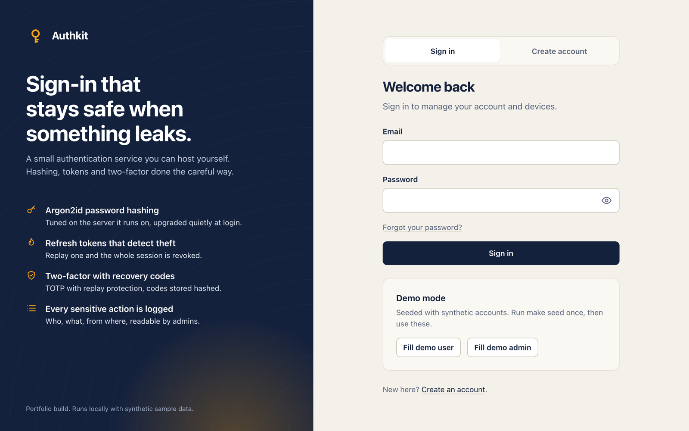
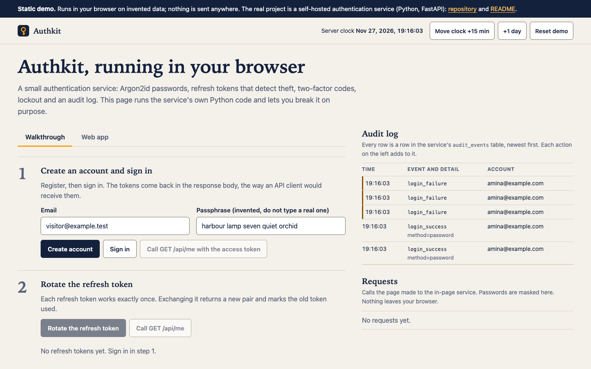
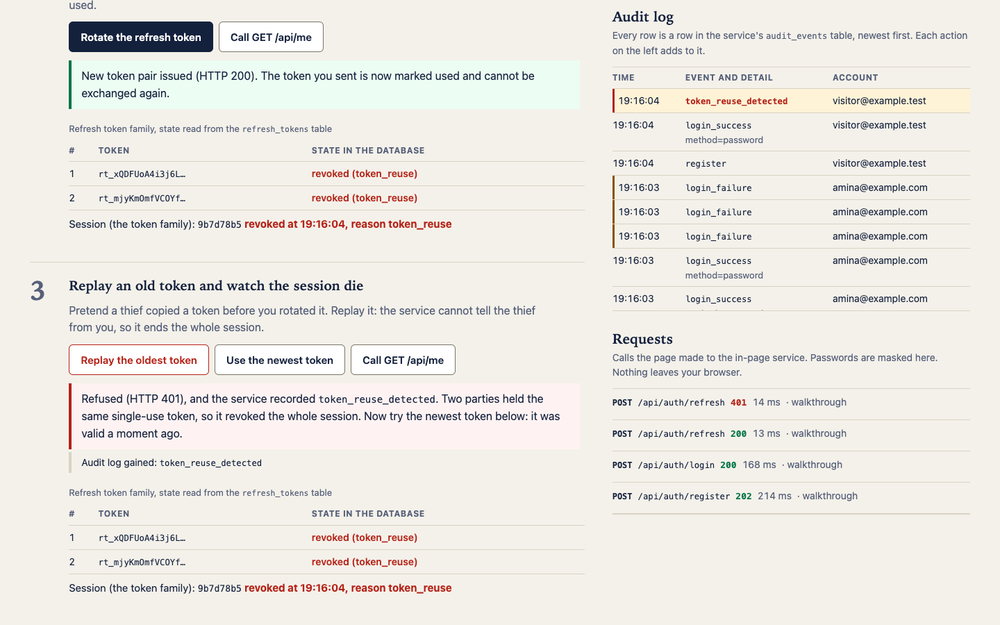
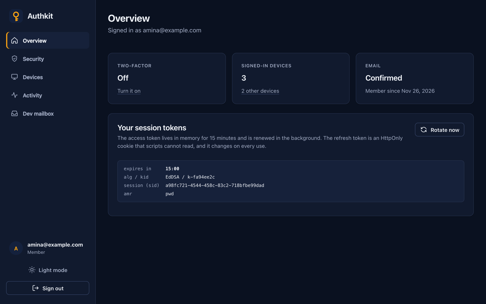
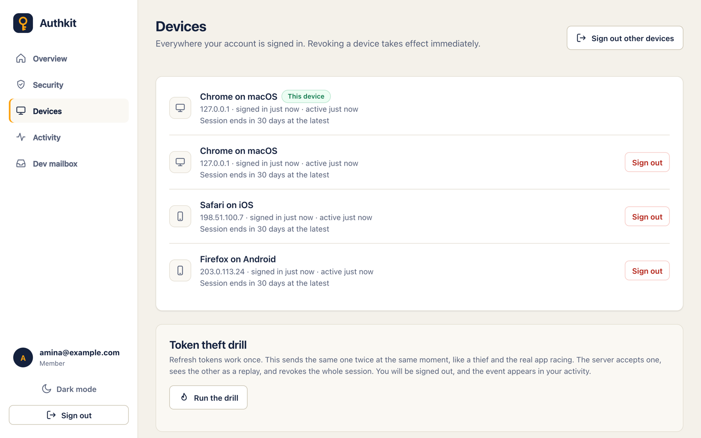
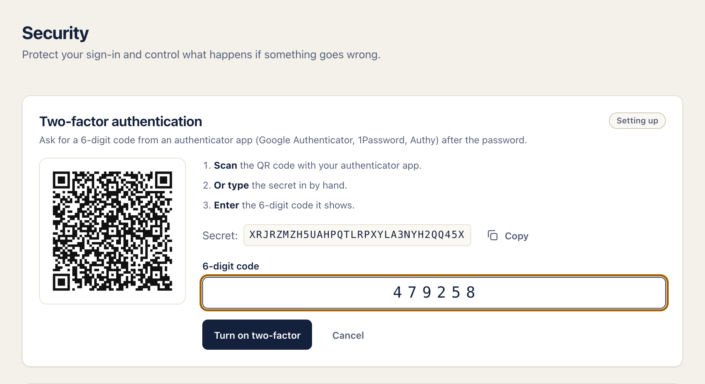
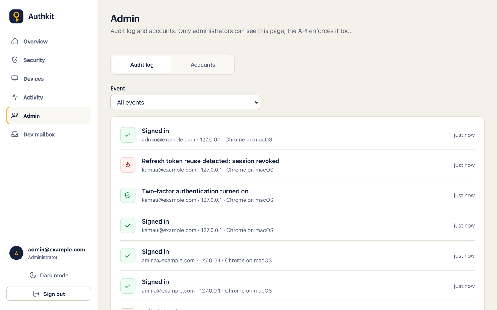
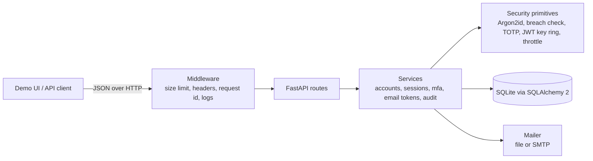

# Authkit

**Live demo: <https://victor-wambua.github.io/authkit/>** (runs the real service in your browser, no server)

**A small, self-hostable authentication service, done properly.** Argon2id passwords, rotating refresh tokens that detect theft, TOTP two-factor and an audit log.

[](https://github.com/Victor-Wambua/authkit/actions/workflows/ci.yml)
[](LICENSE)


> **Status:** portfolio build. Runs locally with synthetic sample data. Not audited, not deployed anywhere, not a replacement for a managed identity provider. See [limitations](#status-and-roadmap).



## Live demo

[victor-wambua.github.io/authkit](https://victor-wambua.github.io/authkit/) runs this service **in your browser**: the unmodified `authkit` package (FastAPI, SQLAlchemy, Argon2id, JWT, TOTP) on [Pyodide](https://pyodide.org/), self-hosted from [`demo/`](demo/). Nothing is sent anywhere and state lives in the tab.

- **Real:** the routes, services and security code, Argon2id at the production cost, Ed25519 access tokens, single-use refresh tokens, reuse detection, TOTP, lockout and the audit log.
- **Replaced:** the HTTP server (`fetch` calls the ASGI app directly), the database file (in-memory SQLite, no threads, so requests run one at a time) and the clock (you can move it forward). It runs on Python 3.14 with Pyodide's library builds, not the 3.12 and `uv.lock` versions CI uses.
- **Try:** register and sign in, rotate a refresh token, replay an old one and watch the session die, turn on two-factor, trigger a lockout. The audit log updates after each step. The **Web app** tab is this repository's own UI.

| | |
|---|---|
|  |  |

Build and test it locally: `python3 demo/build.py`, then `cd demo && npm install && npx playwright install chromium && npm test`. Vendored runtime and wheels (about 20 MB, hashes in `demo/vendor/manifest.json`, licences in the page's third-party notices) are refreshed with `demo/tools/fetch_vendor.py`.

## The problem

Small teams and agencies keep hand-rolling login. The usual result: fast hashes, tokens that never expire, no lockout, and no way to sign a stolen laptop out. One leaked token or one database dump then becomes a breach. Authkit is the boring, careful version of that code, small enough to read in an afternoon.

## What it does

- **Accounts:** register, sign in, sign out, "who am I", change password, delete account.
- **Passwords:** Argon2id with measured parameters, upgraded transparently at login. Length-first policy (NIST SP 800-63B, no composition rules) and a breached-password check using the HIBP k-anonymity range model. A local sorted-hash file backs dev and tests; the real API client is included but never called in tests.
- **Tokens:** 15-minute JWT access tokens (EdDSA or HS256, `kid` rotation) and opaque refresh tokens stored as SHA-256 hashes. Each refresh token works once. **Replaying a used one revokes the whole session.**
- **Devices:** list signed-in devices, revoke one, or "sign out other devices". Revocation applies on the next request, not after the token expires.
- **Two-factor:** TOTP (RFC 6238) with a server-rendered QR, replay protection, secrets encrypted at rest and ten single-use recovery codes stored hashed.
- **E-mail flows:** verification and password reset with single-use, expiring, hashed tokens. Reset signs out every session. Responses are identical for known and unknown addresses.
- **Throttling:** per-account and per-IP sliding window with progressive backoff and a temporary lockout. Configurable.
- **Audit log:** login success and failure, password changes, 2FA changes, token reuse and more, with IP and user agent. Admin-only endpoint to read it. Roles: `user` and `admin`.
- **Hardening:** CSP and other security headers, explicit CORS, request size limit, structured JSON logs with secrets redacted.
- **Demo UI** served by the app (plain HTML, CSS and JS, no CDN, dark mode) and **OpenAPI docs** at `/docs`.

| | |
|---|---|
|  |  |
|  |  |

## Quick start

Needs [uv](https://docs.astral.sh/uv/) (it fetches Python 3.12 itself). No Docker, no database server: SQLite.

```bash
git clone https://github.com/Victor-Wambua/authkit.git
cd authkit
uv sync
make seed     # two synthetic demo accounts, printed to the terminal
make dev      # http://localhost:8000  (PORT=8001 make dev to change it)
```

Open <http://localhost:8000>. Dev mode shows a **Dev mailbox** (verification and reset emails are written to `data/outbox/` and listed in the UI) and "Fill demo user" buttons. API docs: <http://localhost:8000/docs>.

Things to try: turn on two-factor and sign in again; open **Devices** and run the **token theft drill**; sign in as the demo admin and read the audit log.

Production mode is the default when `AUTHKIT_ENV` is unset: it refuses to start without a key file (`uv run authkit init-keys`) and an SMTP mailer. See [`.env.example`](.env.example).

## How it works



Key decisions (details in [docs/CASE-STUDY.md](docs/CASE-STUDY.md)):

- **A session is a refresh-token family.** Reuse of any rotated token kills the family. The single-use check is one atomic `UPDATE ... WHERE used_at IS NULL`, so concurrent replays have exactly one winner.
- **Every authenticated request also checks the session row**, so revoking a device is immediate even though access tokens are stateless JWTs.
- **One answer for "no such user" and "wrong password"**, including the CPU time: unknown accounts verify against a dummy Argon2 hash.
- **All time goes through an injected clock.** Expiry, lockout windows and TOTP steps are tested by moving a fake clock, not by sleeping.
- **The browser UI keeps the access token in memory** and the refresh token in an `HttpOnly`, `SameSite=Strict` cookie (opt-in per request with `X-Auth-Mode: cookie`). API clients get the refresh token in the JSON body instead.

Threats, mitigations and what is out of scope: [docs/THREAT-MODEL.md](docs/THREAT-MODEL.md).

## Testing

```bash
make test     # 264 test cases, offline, about 5 seconds
make cov      # pytest with coverage, fails under 90%
make check    # ruff, mypy, coverage, bandit
```

Last run on my machine: **264 passed**, **96% line+branch coverage** of the `authkit` package (213 test functions, some parametrised). Covered:

- RFC 4226 and RFC 6238 test vectors (SHA-1, SHA-256, SHA-512)
- refresh rotation, reuse detection, family revocation, expiry and the 30-day session cap, and 8 threads racing on one token
- lockout, backoff, sliding window and per-IP limits on a fake clock
- same-shape responses for registration, login and reset with known and unknown addresses
- JWT algorithm confusion, `alg: none`, tampering, key rotation and pruning
- headers, body limits, CORS, forwarded-IP handling, log redaction
- an end-to-end flow: register, verify, sign in, refresh, sign out

Not covered by automated tests: the browser UI itself (I checked it by hand with screenshots), the live HIBP API and a real SMTP server (both mocked).

CI runs ruff, mypy, pytest with coverage, bandit and pip-audit. `pip-audit` reports advisories but does not fail the build, because a vulnerable transitive dependency is not something this repo can fix.

## Project layout

```
src/authkit/
  app.py            application factory, middleware wiring, docs and UI mounts
  config.py         settings (AUTHKIT_* env vars)
  api/              routes: auth, me, mfa, admin, system
  services/         accounts, sessions, mfa, email tokens, audit, maintenance
  security/         passwords, breach, totp, keys (JWT ring), tokens, throttle
  middleware.py     size limit, security headers, request log
  web/              demo UI (index.html, app.css, js/)
  cli.py            init-keys, rotate-key, create-admin, seed-demo, purge ...
tests/              264 test cases
docs/               CASE-STUDY.md, THREAT-MODEL.md, openapi.json, screenshots/
scripts/            tune_argon2.py, timing_probe.py, export_openapi.py
```

## Configuration

The settings you are most likely to change (all `AUTHKIT_`-prefixed; full list in `config.py` and `.env.example`):

| Setting | Default | Meaning |
|---|---|---|
| `ENV` | `production` | `dev` enables file mailer, dev mailbox, `/docs`, auto-created keys |
| `DATABASE_URL` | `sqlite:///./data/authkit.db` | SQLAlchemy URL |
| `KEYS_FILE` | `./data/keys.json` | JWT keys, data key, pepper (mode 600) |
| `ARGON2_MEMORY_KIB` / `TIME_COST` / `PARALLELISM` | 65536 / 3 / 1 | Argon2id cost |
| `BREACH_MODE` | `offline` | `off`, `offline` (sorted SHA-1 file) or `hibp` |
| `ACCESS_TTL_SECONDS` | 900 | access token lifetime |
| `ACCOUNT_FREE_ATTEMPTS` / `LOCKOUT_THRESHOLD` | 5 / 10 | failures before backoff / lockout |
| `TRUSTED_PROXY_HOPS` | 0 | how many proxies' `X-Forwarded-For` to believe |
| `CORS_ORIGINS` | empty | comma-separated explicit origins |
| `MAILER` | `file` | `file` (dev only) or `smtp` |

Key rotation: `uv run authkit rotate-key` adds a new signing key and keeps the old ones verifying; `prune-keys` drops them later.

## Status and roadmap

Portfolio build. Everything above runs and is tested, with these limits:

- **No migrations.** Tables are created on start-up. Alembic would be the first step before any real deployment.
- **Single node.** SQLite, and throttling state lives in the database. No Redis, no multi-instance story.
- **Mocked or unverified:** the HIBP network client (tested with an injected fetcher), SMTP (tested against a fake), and the UI (manual checks only).
- **Not included:** WebAuthn/passkeys, social login, SMS codes, account recovery without email, per-tenant isolation.
- **The bundled breach list is a 110-entry sample**, not the real dataset. Point `BREACH_FILE` at a downloaded one, or use `hibp` mode.
- A concurrent legitimate double-refresh (two tabs at once) is treated as token reuse and signs that device out. That is a deliberate, documented trade-off.

Next steps: Alembic migrations, a PostgreSQL option, WebAuthn, an admin "unlock account" action, and a Redis-backed throttle.

## Author

Built by Victor Wambua. [Portfolio](https://victor-wambua.github.io/victor-portfolio/) · [case studies](https://github.com/Victor-Wambua/case-studies)

Released under the [MIT License](LICENSE).
