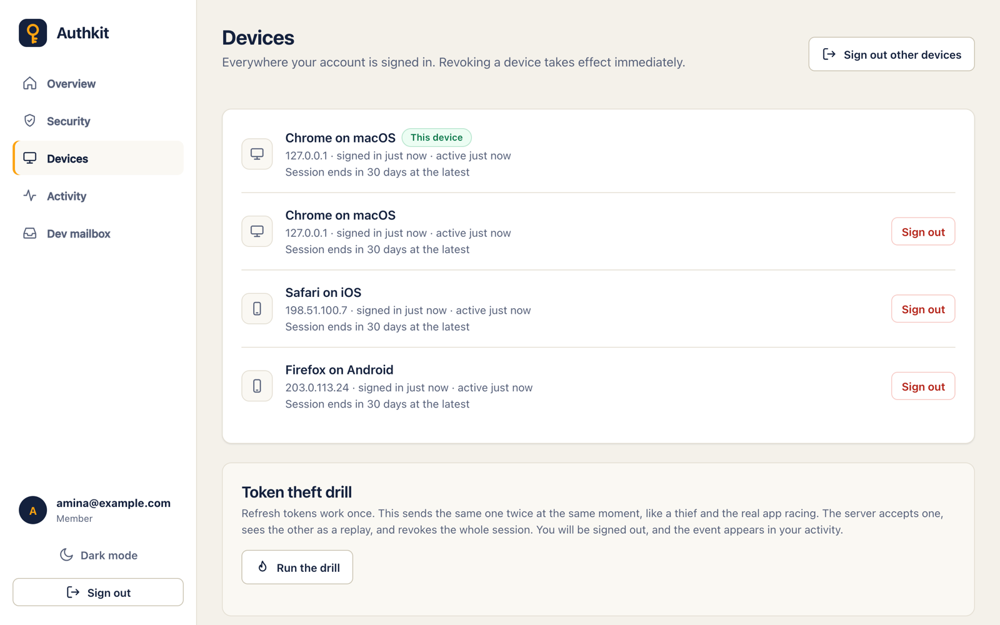

# Authkit: a case study

## The problem

I work on systems that hold other people's money and data, and I keep meeting the same login code. A small team or an agency builds a client app, needs sign-in, and writes it in a week: SHA-256 or bcrypt with a low cost, a JWT that lives for a month, no lockout, and no way to sign out a lost phone. It works until it does not. One leaked token or one database dump becomes a breach, and nobody can say what happened because nothing was logged.

Teams cope in two ways. They buy a hosted identity product, which is often the right answer but adds cost and a data-residency question. Or they copy a tutorial. Authkit is my attempt at a third option: a small service you can read in an afternoon that gets the unglamorous parts right.

## Goals and non-goals

**Goals:** strong password storage, short-lived access tokens, refresh tokens that detect theft, working revocation, TOTP two-factor, no account enumeration, throttling, and an audit trail. Everything testable offline with a controllable clock.

**Non-goals:** WebAuthn, social login, SMS codes, multi-tenant isolation, high availability. Those are listed in the [threat model](THREAT-MODEL.md) as out of scope, not hand-waved.

## What I built

A FastAPI app with SQLAlchemy 2 on SQLite, managed with `uv`. Routes are thin; the rules live in `services/`; the cryptographic parts (Argon2id, TOTP, JWT key ring, throttle, breach check) live in `security/` and know nothing about HTTP. A plain HTML/CSS/JS demo UI is served by the same process.

## Design decisions and trade-offs

### 1. Refresh tokens: one use each, and reuse kills the family

Access tokens are JWTs that live 15 minutes. Refresh tokens are opaque 256-bit random strings, stored only as SHA-256 hashes. Every sign-in creates a *session*, which doubles as the token *family*. Each refresh marks the presented token as used and issues a new one in the same family.

The point is what happens on a second use of an already-used token. Either the client is buggy, or two parties hold the same secret. I cannot tell which, so the whole family is revoked, the user is signed out of that device, and `token_reuse_detected` goes into the audit log with IP and user agent. If a thief rotates first, the victim's next refresh is the one that trips it. Detection happens at the second use, not the first, and I say so in the threat model.

The hard part is concurrency. "Read the token, check it is unused, mark it used" is a classic race. I made the check an atomic compare-and-swap (`UPDATE ... WHERE used_at IS NULL`, look at the row count) and run every SQLite transaction as `BEGIN IMMEDIATE`, so writers queue up front instead of failing at lock-upgrade time. A test fires eight threads at one token: exactly one gets a new pair, the rest get 401, and the family is revoked.

*Alternative considered:* a short grace window so two tabs refreshing together do not log the user out (Auth0 calls this leeway). It lost because a window is exactly the gap a thief needs, and the strict version is simpler to reason about. The cost is real: a legitimate double refresh signs that device out. The demo UI avoids it with a single in-flight refresh promise.

*Second decision here:* authenticated endpoints check the session row as well as the JWT. That costs one lookup per request and buys immediate revocation. A resource server that verifies tokens offline will still accept a revoked token until it expires; that is documented, not hidden.

### 2. Argon2id parameters, chosen by measurement

I do not trust copied parameters, so `scripts/tune_argon2.py` times candidates on the machine. These are **my numbers on one machine** (Apple M4 laptop, macOS, Python 3.12, median of 15 hashes), not a benchmark of yours:

| Parameters | Median |
|---|---|
| OWASP minimum, m=19 MiB t=2 p=1 | 11.5 ms |
| m=64 MiB t=2 p=1 | 46.4 ms |
| **m=64 MiB t=3 p=1 (default)** | **69.8 ms** |
| RFC 9106 low-memory, m=64 MiB t=3 p=4 | 21.3 ms |
| m=128 MiB t=3 p=1 | 147.7 ms |

I picked 64 MiB, t=3, p=1: roughly 70 ms, which is noticeable only to an attacker doing it billions of times, and 64 MiB per guess is the cost that hurts GPUs. The p=4 row looks faster, but only because it spends four cores at once; on a busy server handling concurrent logins that is not a saving. Parallelism 1 keeps the cost predictable. Run the script on the real host and move the numbers if the budget differs. Because every successful login runs `check_needs_rehash`, raising the settings upgrades users as they sign in.

The password policy follows NIST 800-63B: length first (12 minimum), no composition rules, no forced rotation, NFKC normalisation, and a breached-password check through the k-anonymity range model. Only the first five hex characters of the SHA-1 ever leave the process. The offline implementation does a binary search over a sorted file, so tests never touch the network.

### 3. Enumeration resistance, including the clock

Register, forgot-password and login give the same status and body for known and unknown addresses. Registering an address that exists returns the same `202` and sends "you already have an account" to the real owner. Throttling is keyed by the submitted address whether or not it exists, so a 429 reveals nothing.

Timing is the harder half. For unknown or inactive accounts the service verifies against a dummy Argon2 hash built with the same parameters, so the work matches. Mail goes out in a background task. I measured it with `scripts/timing_probe.py`: with production parameters, interleaved, 40 wrong-password logins each, medians were 96.0 vs 96.4 ms and, on a second run, 81.8 vs 83.0 ms. My first, non-interleaved run showed a 10 ms gap that turned out to be drift between the two batches. This is evidence, not a proof of constant time: database lookups and other small differences remain.

### 4. TOTP: replay protection and what is stored

TOTP is implemented from RFC 6238 and checked against the RFC's published vectors for SHA-1, SHA-256 and SHA-512. Accepting a ±1 step window is a convenience for clock drift, but it also makes a code valid for up to 90 seconds, so the last used step is stored and anything at or before it is rejected, atomically. Secrets are encrypted at rest with a Fernet data key, so a database dump alone does not give an attacker the second factors. Recovery codes carry 80 bits and are stored as HMAC-SHA-256 with a server pepper, because a plain hash of a short code can be brute-forced from a dump.

### 5. Keys and rotation

Tokens are signed with EdDSA by default (HS256 is supported). Each carries a `kid`. Rotation adds a new active key and leaves old ones verifying; pruning removes them later. The verifier never trusts the header's `alg`: it takes the algorithm from the key the `kid` names, which closes `alg: none` and the "public key as HMAC secret" trick, both tested.

## How it's kept correct and safe

**Fake clock everywhere.** Every "now" goes through an injected clock, so token expiry, lockouts, reset links and TOTP steps are tested by advancing time, not sleeping. That surfaced a real wrinkle: PyJWT checks `exp` and `iat` against the wall clock, which fights a fake one, so the verifier checks time claims itself.

**Tests (264 cases, 96% line+branch coverage, all offline).** Besides the RFC vectors, they cover reuse and the thread race, lockout arithmetic, same-shape responses, key rotation, headers, body limits, CORS, log redaction and the end-to-end flow. Writing them found bugs: a digit run like `123456789012` slipped past my "sequential" check because it wraps from 9 to 0; and my own lockout test showed that a lockout ends when failures slide out of the window, which is why the window must be at least as long as the lockout (the config enforces it).

**Failure modes I hit while building:**
- The strict CSP blocked my own inline `style` attributes; I moved them to classes rather than loosen the policy.
- `segno`'s inline SVG came without a `viewBox` or namespace, so the QR code rendered as a blank white box in the browser even though the server tests passed. Found by looking at the screenshot.
- FastAPI turns an exception raised while reading a body into a 400, which would have hidden the 413 for oversized streamed requests. The limit error is now an `HTTPException`.
- FastAPI's default validation error echoes the submitted values, including passwords. The handler drops them.

**Privacy.** Logs redact passwords, tokens and JWTs by key and by pattern. Audit rows never contain secrets (tested). The reset link carries its token in the URL fragment, so it never reaches server logs or `Referer`.

## What I'd do differently, and what a production checklist still needs

If I started again I would add migrations from day one and put throttle state behind an interface so Redis could replace the table. I would also decide the two-tab refresh policy with real client code in front of me.

Before this faces real users, I would add: Alembic migrations and PostgreSQL; WebAuthn or passkeys; TLS and proxy configuration reviewed together with the trusted-hop setting; keys in a secrets manager with a rotation schedule; an alert on `token_reuse_detected` and on lockout spikes; audit log shipping to storage the app cannot edit, with a retention rule; a data-protection review of what the audit log keeps after deletion; global concurrency limits for the hashing endpoints; admin MFA enforcement and an unlock action; a dependency update routine; and an independent security review. Few of these are code. Most are operations.

## Status

Portfolio build. It runs locally with synthetic sample data (`make seed`). Not deployed, not audited. Mocked or unverified: the live HIBP API (tested through an injected fetcher), real SMTP (tested against a fake), and the browser UI (checked by hand, not by automated tests). The bundled breach list has 110 entries and is a sample.
